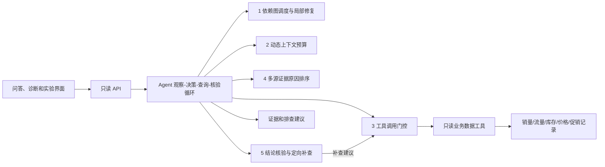

# 电商经营异常诊断系统

面向单店单 SKU 的销量下降诊断。系统读取销量、访客、支付订单、库存、价格和促销的逐日记录，执行只读的 Agent 查询循环，输出候选原因、证据、反证、缺口和经营排查建议。工作台可导入自有数据；内置示例和算法实验使用**合成数据**。所有结论均为“优先排查的可能原因”，排序分数不是因果概率。

## 当前进展

这是一个可在本地运行的课程项目原型。已完成 CSV/JSON 导入与数据预检、只读诊断 Agent、任务状态和报告接口、聊天式本地报告问答、诊断与实验页面、五个算法模块的代码及合成案例对照评测。当前问答**没有接入大模型**，真实电商平台数据接口、账号体系、持久化存储和线上部署也尚未完成。五位成员的姓名表示项目计划分工；仓库现有代码证明模块已实现，不能仅凭仓库证明每个人分别完成了哪些提交。

### 已实现的功能

- **经营数据导入与预检**：导入按日 CSV 或完整 JSON；校验单店单 SKU、对照期与异常期、字段类型、来源时间、缺失值与真实 0，并显示覆盖率和多来源冲突。内置合成示例可直接体验流程。
- **只读诊断 Agent**：通过范围受限的数据工具读取销量、订单、访客、库存、价格和促销；执行任务调度、证据筛选、原因排序、结论核验与定向补查，记录执行轨迹，不自动改价、补货或投放。
- **本地服务与报告**：提供数据预检、异步诊断任务、状态查询、最近任务列表和 JSON 报告下载接口；任务有并发和数量上限，进程重启后历史清空。
- **三个界面**：智能问答首页、数据与诊断工作台、五模块算法实验页。工作台展示销量趋势、候选原因、支持和反对证据、数据来源与排查建议；问答仅根据已完成的结构化报告回答，尚不调用大模型。
- **实验和文档**：包含五模块的普通基线、消融或边界实验、逐例合成评测数据，以及数据契约、接口、实验方案、创新性审计和独立验证方案。

最近一次本地核对：`npm test` **93/93 通过**，`npm run eval` 成功生成五模块结果。48 个合成案例中，12 个用于初期开发、36 个用于固定评测；后 36 个已被用于集成调试，不属于未接触的盲测。各模块的具体指标与未显示收益的对照项均记录在 [`docs/innovation-audit.md`](docs/innovation-audit.md)。这些结果只说明当前原型在指定合成场景中的表现。

## 成员分工、算法改进与下一步

下表中的“改进”是相对本项目设定的普通 Agent 或固定规则基线，不代表学术首创。实现入口见 `src/algorithms/`，集成流程见 `src/agent/diagnose.ts`，实验方案与当前证据边界见 [`docs/evaluation-plan.md`](docs/evaluation-plan.md) 和 [`docs/innovation-audit.md`](docs/innovation-audit.md)。

| 负责人 / 模块 | 功能与相对基线的算法改进 | 已实现与验证 | 接下来怎么做 |
| --- | --- | --- | --- |
| **Yan Zhuo · 任务调度与局部修复** | 把诊断步骤建成依赖图，按异常程度、下游影响和成本选择就绪任务；失败时沿依赖关系只重跑受影响节点，而非整条流程重跑。 | 已实现依赖验环、并发调度和局部修复；集成 Agent 初查，单元与故障注入测试覆盖；合成任务模拟与 FIFO/整图重跑对照。 | 用真实工具调用记录测端到端耗时；将最终结论核验失败后的定位修复接入执行器，并扩大任务图与故障类型。 |
| **Yan Han · 动态上下文预算** | 对中文及高密度内容修正 Token 估算，按配置窗口预留空间，优先保留销量、缺货和反证摘要，再按剩余预算升级全文。 | 已实现密度估算、预算分配和重要证据优先选择；有固定场景与截断基线对照。 | 接入实际模型后用其 tokenizer/用量独立核对估算误差，并检验摘要事实一致性和回答引用质量。 |
| **Zheng Sitian · 工具调用决策** | 调用前分层检查权限、数据源状态、指标范围、前置条件和业务风险，返回执行、阻止或请求审批；比直接执行/单一权限检查更细。 | 已实现门控和只读数据工具的范围二次校验；策略矩阵、越界与来源变化测试已覆盖。当前诊断仅执行低风险只读查询。 | 接入真实数据源权限和人工审批流程，以独立设计的策略案例测试误阻断、漏阻断及状态变化。 |
| **Li Yiheng · 多源证据原因排序** | 汇总销量、流量、订单、库存、价格、促销的变化时序，按证据强度、数据质量及反证动态评分；区别先发原因和后续加重因素。 | 已实现缺货、流量下降、转化下降、价格/促销变化的候选排序与证据追溯；有固定规则基线、消融和压力案例。 | 由未参与规则设计的人构建新案例并标注，重点验证时序、质量、反证各组件和混合原因。 |
| **Li Zhen · 结论核验与定向补查** | 先核对销量降幅、证据覆盖、冲突和替代解释，再按缺口与查询成本选择下一项只读查询；证据不足时保留判断。 | 已实现核验、定向补查建议及最多一次冲突复查；补查再次经过工具门控，并有无核验/固定顺序对照。 | 增加不同查询成本与数据源失败场景；用独立标注同时比较结论正确率、弃权率、调用次数和延迟。 |

**共同工作**：前后端与数据契约、合成数据和测试、系统集成、实验记录、报告与演示。下一阶段先取得授权的匿名经营数据和独立标注，再接入真实平台只读 API；收到模型服务的接口文档后，将大模型调用放在后端，密钥只由服务端管理。上线前还需增加鉴权、持久化、部署配置与运行监控。

## 快速运行

需要 Node.js 24 或更新版本；当前版本没有第三方运行依赖。

```bash
npm test
npm run eval
npm run dev
```

打开 `http://127.0.0.1:4173`。首页是**智能问答**：可询问数据导入方法，诊断完成后可围绕当前报告提问原因、证据、数据缺口与经营建议。当前问答来自本地结构化报告，**尚未接入大模型 API**。在“数据与诊断”页填写单店单 SKU 的范围和来源时间，导入每日 CSV；也可用高级方式导入完整 JSON，格式见 [`docs/data-contract.md`](docs/data-contract.md)。页面先预检六项指标的时间窗覆盖和冲突，再提交诊断任务，查看销量趋势、候选原因、证据、建议与任务历史，并下载完整报告。内置的“载入示例”只用于演示，始终明确标记为**合成数据**；导入者声明为真实数据也不等于平台已认证。“算法实验”页显示五模块的基线、消融和逐例结果。

诊断接口包括 `GET /api/datasets/example`、`POST /api/datasets/validate`、`POST /api/runs`、`GET /api/runs`、`GET /api/runs/{runId}` 和 `GET /api/runs/{runId}/report`。问答接口为 `GET /api/assistant/status` 与 `POST /api/assistant/messages`，详见 [`docs/diagnosis-api.md`](docs/diagnosis-api.md)。旧的同步接口 `POST /api/diagnose-dataset` 及合成案例接口继续可用。`npm run eval` 把可复现的实验结果写入 `eval/results/latest.json` 和 `eval/results/case-results.csv`；实验页读取最新结果，未运行时显示“未运行”。

也可直接用本地 JSON 数据运行同一 Agent 核心：

```bash
npm run example
npm run diagnose -- examples/synthetic-stockout.json
```

示例文件明确标记为合成数据。自有数据字段与口径见 [`docs/data-contract.md`](docs/data-contract.md)。命令行只读文件并向标准输出写报告，不执行任何经营写操作。JSON 文件来源由提供者声明，程序无法替业务平台认证。

## 后端接口与可靠性边界

服务只监听 `127.0.0.1`，上传接口接受同源页面或本地命令行请求。`POST /api/diagnose-dataset` 校验店铺、SKU、时间窗、指标单位、整数计数、带时区时间戳和逐日记录唯一性；请求正文最多 1 MiB，读取超时 10 秒。格式错误、超限、媒体类型错误分别返回 400、413、415，未预期的服务错误返回 500。上传数据只在本次请求内处理。问答接口只读取已完成的内存报告，当前不会向外部模型发送数据；将来接入模型时应由后端保存密钥并控制传入模型的报告内容。

任务接口可用相同 JSON 调用 `POST /api/runs`，获得 `202`、`runId` 与 `statusUrl`；随后通过 `GET /api/runs` 查看列表，或 `GET /api/runs/{runId}` 查看排队、运行、完成、失败状态及完成后的报告。默认最多保留 20 条任务、同时运行 2 条，容量满且全是未结束任务时返回 429。任务和报告只保存在服务进程内，重启后清空。

导入结果的 `sourceDeclaration.synthetic` 为 `true`、`false` 或 `null`（未声明），`authenticated: false` 表示来源未经平台认证。多个来源在同一天同一指标给出冲突数值时，趋势接口将该值留空并在 `series[].metricStates` 中标为 `conflict`，避免图表随机选取一条记录。诊断算法仍保留全部原始观测和来源冲突证据。

Agent 对每次只读工具查询设默认 30 秒上限，支持 `AbortSignal` 协作取消；超时不会重试仍可能运行的调用。普通暂时失败在修复预算内重试；冲突或低质量指标最多定向复查一次，新批次通过完整校验后才替换旧数据。补查失败或预算耗尽时返回“证据不足”及原因。核验结论前还要求销量相对基线至少下降默认 10%（可配置的业务筛查阈值），避免把微小波动判断为异常。当前 JSON 适配器是内存只读快照；真实电商平台 API、用户认证和持久化任务队列尚未接入。

## 系统层级



主要代码：

| 位置 | 作用 |
| --- | --- |
| `src/domain` | 单 SKU、两个时间窗、指标、证据和结论的契约与数据校验 |
| `src/data` | 确定性的合成数据、JSON 导入校验与只读查询适配器 |
| `src/algorithms` | 五个模块的算法实现 |
| `src/agent` | 有查询上限的 Agent 状态循环；每次补查再次经过工具门控 |
| `src/server.ts`、`web` | 零依赖 HTTP API 与中文可视化 |
| `eval`、`test` | 基线/消融/鲁棒性实验与单元、集成测试 |

## 五个模块的可执行边界

1. **诊断任务调度与局部修复**：依赖图验环、就绪节点排序、并发限制、失败节点下游重跑范围。Agent 的初始销售、流量、排序、核验任务由同一执行器调度；工具返回暂时无效时，限定次数重跑失败节点及其下游任务，保留无关节点结果。集成测试注入了跨 SKU 的暂时错误并验证流量查询只执行一次。
2. **动态上下文预算**：根据配置的模型窗口和预留 Token 量计算证据预算，估算普通文本、中文和长密集编码结果的 Token 量；先选择销量/缺货等证据摘要，再用剩余预算升级全文。当前没有接入模型提供商的窗口读取或真实 tokenizer；估算值不能替代硬限制。
3. **工具调用决策**：先检查只读/权限，再检查来源激活、状态、指标范围、前置条件和业务风险，返回执行/阻止/请求审批。工具适配器还必须独立校验店铺、SKU 和时间窗。
4. **多源证据原因排序**：针对缺货、流量下降、转化下降、价格或促销变化，结合时序、质量、反证排序；所有证据可追溯到原始观测 ID。对混合原因保留“先发生的原因”和“后续加重因素”。
5. **结论核验与定向补查**：先检查销量降幅，再根据缺失、过期、冲突和替代解释选择下一项只读查询；冲突或低质量指标可复查一次，仍无法支持时保留判断。补查建议必须再经过模块 3。

## 实验与限制

实验方案见 [`docs/evaluation-plan.md`](docs/evaluation-plan.md)，创新性审计见 [`docs/innovation-audit.md`](docs/innovation-audit.md)，下一轮盲测与标注流程见 [`docs/independent-validation-protocol.md`](docs/independent-validation-protocol.md)。当前 48 个合成案例中 12 个用于初期开发，36 个用于固定评测；后者已被用于集成调试，**不再视为完全未接触的盲测集**。实验包括普通基线、逐项消融、逐例输出和配对区间。合成数据的高分只证明代码对这些已定义场景有效，不能代替真实店铺数据、独立人工标注或学术新颖性检索。

本版不自动执行补货、调价、投放等经营操作。真实数据接入时应先取得授权并核对指标口径、时区、更新周期和权限范围。

## 界面设计来源

界面设计参考了 MIT 许可的 [nextlevelbuilder/ui-ux-pro-max-skill](https://github.com/nextlevelbuilder/ui-ux-pro-max-skill)。本仓库保留由其辅助生成的 [设计规范](design-system/commerce-diagnosis/MASTER.md)，下载的上游 skill 保存在本地 `.agents/skills/`，不随本项目代码重新分发。首页采用简洁的聊天布局；数据导入反馈、时序图和实验结果分别保留在独立视图。
